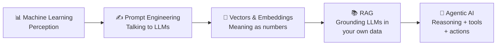
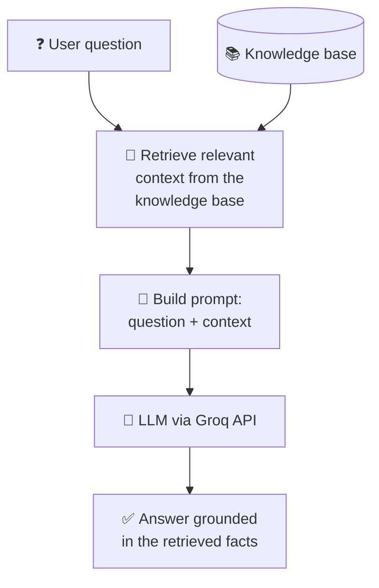

# 🤖 Machine Learning to Agentic AI

> Hands-on notebooks that follow the path from classic machine learning to modern Generative AI: prompt engineering, vector embeddings and Retrieval-Augmented Generation (RAG), the building blocks of AI agents.


## 📌 Overview

AI is moving from **perception** (models that recognise images, text and speech) to **autonomy** (agents that reason, retrieve information and take actions). This repository is a practical learning track for that shift. Each notebook covers one core skill needed to build LLM applications and AI agents, with runnable code.

## 🗺️ Learning path



## 🏗️ How the RAG pipeline works



## 📒 Notebooks

| Notebook | Topic | What you learn |
|---|---|---|
| `Prompts_LLM/` | Prompt engineering | Writing clear, effective prompts for large language models |
| `Vector_and_Embedding.ipynb` | Embeddings and similarity | Representing text as vectors and comparing them with cosine similarity (applied to sentiment analysis) |
| `RAG_Day_1.ipynb` | Retrieval-Augmented Generation | Supplying an LLM with an external knowledge source so it answers from authoritative data instead of only its training data |

## 🧰 Tech stack

Python · Jupyter / Google Colab · Groq LLM API · NumPy · scikit-learn

## ⚙️ Getting started

```bash
git clone https://github.com/SaurabhSharma2388/Machine-Learning-to-Agentic-AI.git
cd Machine-Learning-to-Agentic-AI
pip install groq numpy scikit-learn jupyter
export GROQ_API_KEY="your_key"
jupyter notebook
```

Each notebook also has an **Open in Colab** link.

## 🔭 Coming next

- Vector databases (FAISS, Chroma) for semantic search at scale
- Tool calling and multi-step AI agents
- Evaluating RAG quality (faithfulness and context accuracy)

## 👤 Author

**Saurabh Sharma** – Senior Data Scientist & Generative AI Engineer
[LinkedIn](https://www.linkedin.com/in/saurabh-sharma-data-scientist/) · [GitHub](https://github.com/SaurabhSharma2388)
